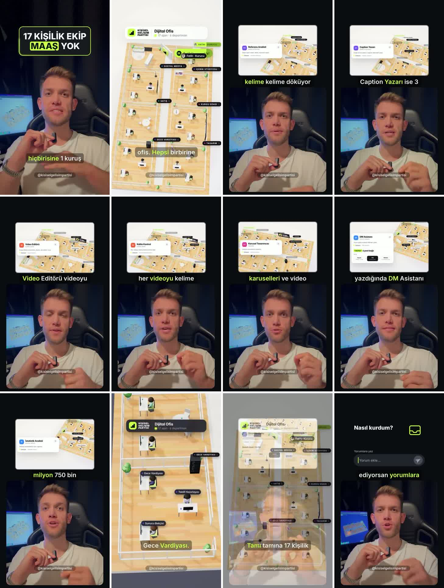

# Video by kisiselgelisimpartisi

- **Link:** https://www.instagram.com/reel/Df2Rf1YoVEw/
- **Hesap:** Fatih Furkan Ak (16210224507)
- **Süre:** 59.115147 sn · **Dil:** tr
- **Beğeni / yorum / izlenme:** 382 / 2214 / None

## Açıklama metni

Yorumlara OFİS yaz, bu sistemi nasıl kurduğumu anlatan ücretsiz rehberi DM’den göndereyim.

Maaş bütçeni büyütmeden Claude Code ile içerik hazırlığında iş bölümü yapabilirsin. Referans videonun kelime kelime dökümünü bir ajana hazırlatıp zamanını çekime ayırabilirsin.

## Konuşma dökümü

```
[000.0s] 17 kişilik bir sosyal medya ekibim var ve hiçbirisinde bir kuruş bile ödemiyorum.
[003.7s] Hepsini cloud kodla kurdum.
[005.2s] Bu, yapayızdaki ajanlarımın çalıştığı ofisi hepsi birbirine iş bastılıyor.
[008.7s] Sabah bir referans videoyu atıyorum, preferanstan liste videoyu indiriyor, kelime kelime döküyor ve kancasını çözüyor.
[014.3s] Metin yazarı aynı gün çekeceğim videonun metnine yazıyor, Kepşin yazarı ise 3 ayır seçenek çıkartıyor.
[019.2s] Ben sadece ham videoyu çekiyorum, gerisi kuru kodasında.
[022.1s] Videoditörü videoyu temizliyor, sesleri ayıklıyor ve alt yazıyı koyuyor.
[025.6s] Kalite kontrol ekibi her videoyu kelime kelime analiz ediyor, bir hata varsa teslim ettirmiyor.
[030.2s] Tasarım ekibi haftanın 7 günü için karuselleri ve videokapaklarını 10 dakikada hazırlıyor.
[034.8s] Birisi yorumlara anahtar kelimeyi yazdığında, DM assisten otomatik olarak linki ona gönderiyor.
[039.2s] İstatistik analisti ise bakıyor, son 30 günde 1.750.000 görüntülenme.
[043.2s] Çoğu da beni hiç tanımayanlardı.
[044.6s] Ama en sevdiğim departman burası, Gece Vardiyası.
[047.3s] Ben gece uyurken o iş kuruklarını yürütüyor, sabah 8'de raporu masama bırakıyor.
[051.6s] Tamı tamına 17 kişilik bir ekip.
[053.5s] Ne maaş var ne mesai.
[055.0s] Nasıl kurduğumu merak ediyorsan yorumlara ofis yaz, sana DM'den göndereyim.
```

## Kareler (12 adet)


